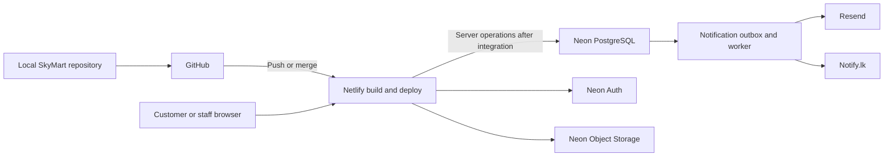

**SkyMart: GitHub → Netlify deployment and production setup guide**

Prepared 13 November 2026 for `C:\Users\SMT\Desktop\loopBound\SkyMart`.

This guide matches the current repository. Commands are for Windows PowerShell. Replace uppercase placeholders before running them. Provider dashboard labels can change; linked official documentation accompanies the relevant steps.

**Start here: what you can deploy today**

The current application is a working browser-local demo. You can publish it through GitHub and Netlify immediately without a database or API keys. It includes the storefront, catalogue, enquiries and staff tools, but every browser stores its own demonstration records. Opening the deployed domain will not import the records from localhost.

Production needs additional application development. Creating accounts and pasting credentials will not connect the demo to those services. Steps 1–5 publish the demo; steps 6–12 prepare the production services and identify the code that must be implemented; steps 13–15 cover launch and maintenance.

| Component | Service / technology | Current state |
| --- | --- | --- |
| Source control | GitHub | Local Git repository initialized; no remote configured when checked |
| Website and application server | Next.js + TypeScript on Netlify | App and `netlify.toml` ready for an initial demo deployment |
| Shared records | Neon PostgreSQL + Drizzle | Schema, initial migration and client factory exist; UI integration pending |
| User identity | Neon Auth / Managed Better Auth | Not implemented |
| Uploaded product photos | Neon Object Storage | Not implemented; bundled sample SVGs already work |
| Image optimization | Netlify Image CDN through `next/image` | Planned; current components use plain `img` elements |
| Transactional email | Resend | Not implemented |
| Sri Lankan service SMS | Notify.lk, if selected | Not implemented |



The arrows to backend services describe the intended production system. They are not active in the current demo.

**1. Prepare accounts and your local checkout**

Have access to GitHub and Netlify first. You can create Neon, Resend and Notify.lk accounts when you reach their sections. A custom domain and DNS access become necessary for your branded website and verified email sending.

Use the business's accounts where practical. Enable account recovery and two-factor authentication for the service dashboards. Keep service credentials in a password manager and environment settings.

Open PowerShell:

```powershell
Set-Location 'C:\Users\SMT\Desktop\loopBound\SkyMart'
node --version
npm --version
git --version
git status
git branch --show-current
git remote -v
```

The expected local branch at preparation time is `codex/skymart-foundation`; Git is already initialized. The hosting configuration uses Node.js 22, so use Node.js 22 locally as well when preparing deployment. Stop the local development server before a clean dependency install or release build.

```powershell
npm ci
npm test
npm run build
npm run typecheck
```

Run these separately and stop if any command fails. `npm ci` uses the committed lockfile. Running the build before the standalone type check also generates Next.js route types in a clean checkout. The initial project has eight domain tests; this does not replace future authentication and API tests.

**Checkpoint:** tests, build and type check pass locally.

**2. Create the GitHub repository and push your first commit**

In GitHub, create an empty repository named `SkyMart`. Choose private if you want to restrict source access. Leave the README, license and `.gitignore` initialization options unchecked because this project already has its own files.

Review `.gitignore`. It excludes `.env*`, `node_modules`, `.next`, logs and TypeScript build caches, while allowing the empty `.env.example` template. Never add service credentials to source files or `netlify.toml`.

```powershell
git add .
git diff --cached --stat
git diff --cached
git status --short
```

Review the staged content. Include `src`, `public`, `tests`, `docs`, `drizzle`, configuration files and `package-lock.json`. Exclude actual environment files and generated dependency/build folders. If you stage a secret before this first commit, remove it from the index with `git rm --cached -- .env` using the actual filename; keep the local file ignored. If a secret was already pushed, revoke it immediately and address the Git history as a separate recovery task.

If Git asks for identity, configure your name and GitHub email for this repository:

```powershell
git config user.name "YOUR NAME"
git config user.email "YOUR GITHUB EMAIL"
```

Create the first commit, rename this initial branch to `main`, and add your remote. These commands assume there is no existing `main` branch or `origin`, as was the case when this guide was prepared.

```powershell
git commit -m "Initial SkyMart catalogue and stock workspace"
git branch -m main
git remote add origin https://github.com/YOUR-USERNAME/SkyMart.git
git remote -v
git push -u origin main
```

Complete GitHub's supported sign-in flow if prompted. Refresh the repository page and confirm the source files appear. If `origin` already exists, inspect it before changing anything; do not add it twice or force-push to resolve an unexpected error. These steps follow [GitHub's existing-code import workflow](https://docs.github.com/en/migrations/importing-source-code/using-the-command-line-to-import-source-code/adding-locally-hosted-code-to-github).

**Checkpoint:** GitHub shows the project on `main`, with no credentials or `node_modules` uploaded.

**3. Import GitHub into Netlify**

In your Netlify team dashboard, choose **Add new project → Import an existing project → GitHub**. Authorize access to the SkyMart repository, select it, and choose `main` as the production branch. Netlify supports repository-linked continuous deployment; later pushes to the selected branch trigger deployments. See [Netlify's repository deployment steps](https://docs.netlify.com/start/quickstarts/deploy-from-repository/).

Use these settings for this repository:

| Setting | Value |
| --- | --- |
| Framework | Next.js |
| Production branch | `main` |
| Base directory | Repository root; leave blank |
| Package directory | Repository root, if this field is shown |
| Build command | `npm run build` |
| Publish directory | `.next` |
| Node version | `22` |
| Environment secrets for the current demo | None |

The existing `netlify.toml` contains:

```toml
[build]
  command = "npm run build"
  publish = ".next"
[build.environment]
  NODE_VERSION = "22"
```

The GitHub repository root should directly contain `package.json`. Do not enter the Windows filesystem path as the Netlify base directory.

Keep Netlify's automatic Next.js/OpenNext integration. Do not replace the application with a static export, use `npm run dev` as its build command, or add a catch-all SPA redirect to `index.html`. Netlify's adapter handles Next.js server routes and page rendering. See [Next.js on Netlify](https://docs.netlify.com/build/frameworks/framework-setup-guides/nextjs/overview/).

Click **Publish** or **Deploy**, then inspect the build log. A successful local build is useful evidence, but the first Netlify build still needs its own verification.

**Checkpoint:** Netlify reports a successful deploy and provides your project's `https://YOUR-PROJECT.netlify.app` address.

**4. Verify the deployed demo**

Open the Netlify address and check these paths:

| Path | Expected result now |
| --- | --- |
| `/` | Storefront and sample illustrations |
| `/products` | Search, categories and stock filter |
| `/products/urban-glide` | Sample product details |
| `/about` | SkyMart introduction |
| `/contact` | Local demo enquiry form |
| `/account` | Honest account-setup placeholder |
| `/admin` | Labelled demo staff workspace |

Refresh a product page directly to check routing. Try a phone-sized viewport. Submit a demo enquiry and find it in `/admin` in the same browser. Test a stock change and reload. Open a private/incognito window: it should have its own sample dataset because shared storage is not connected yet.

Check the project's visitor access settings. Netlify documents private-by-default behavior for new credit-based teams; do not assume the generated URL is public. Use the dashboard's access settings deliberately, and test in an unauthenticated browser when sharing the preview. See [Netlify's access note for repository deployments](https://docs.netlify.com/start/quickstarts/deploy-from-repository/).

The current `robots` metadata disables indexing. Keep it that way for the demo. The accessible demo staff screen only changes that browser's sample data; real stock administration must have server-enforced authentication before launch.

**Checkpoint:** the hosted demo works. This is a useful stopping point while production integrations are developed.

**5. Connect your domain and HTTPS**

After the Netlify address works, open **Domain management → Production domains → Add a domain** and enter a domain you own. Choose one primary address, such as `www.YOUR-DOMAIN`, and configure the other form to redirect to it.

You can keep DNS with your current provider. Open **Pending DNS verification** in Netlify and copy the exact records Netlify supplies into your DNS provider. Use the displayed apex and `www` instructions; do not copy an IP from an old tutorial. Preserve existing email-related DNS records. Netlify's [external DNS guide](https://docs.netlify.com/manage/domains/configure-domains/configure-external-dns/) explains the domain-specific records and propagation.

Once DNS resolves, confirm that Netlify's certificate is issued and the site opens over HTTPS. Check both your chosen primary domain and the redirect. A domain change creates a different browser storage origin, so demo records from the Netlify subdomain will not appear automatically on the custom domain.

**Checkpoint:** HTTPS works on the chosen address, which you can now use for authentication redirects and email links.

**6. Choose the production region and environment layout**

For the planned Sri Lankan audience, consider Singapore for both the Netlify application functions and Neon database. Netlify currently limits function-region selection to Pro and Enterprise plans; its default for new projects is Ohio. Set a Next.js project's region using Netlify's project-level UI because its functions are generated by the framework adapter. Confirm plan eligibility before selecting this arrangement. See [Netlify function-region configuration](https://docs.netlify.com/build/functions/configuration/).

For an economical development setup, keeping both services in Ohio is another option. Choose deliberately before entering production data. Neon Object Storage currently supports Ohio, N. Virginia, Frankfurt and Singapore. See [Neon's storage prerequisites](https://neon.com/docs/storage/get-started).

Recommended separation for SkyMart:

| Environment | Code / deployment | Backend |
| --- | --- | --- |
| Local development | Local feature branch | Neon development branch, fake data |
| Staging | Separate `skymart-staging` Netlify project linked to `develop` | Neon staging branch, test users and credentials |
| Production | Main Netlify project linked to `main` | Production database/auth/storage and approved business data |
| Pull request preview | Netlify Deploy Preview | Explicitly assigned test backend or demo mode |

A stable staging hostname makes auth testing easier. Do not let arbitrary preview deployments inherit production database or message credentials. Git branches, Netlify deployments and Neon branches are separate resources: naming them similarly does not link them automatically. A Neon data branch can inherit sensitive rows from its parent, so use fake or sanitized data for development.

**Checkpoint:** you know which exact application URL and Neon branch each environment will use.

**7. Create Neon and apply the schema to development first**

In the Neon Console, create or select the SkyMart project in your chosen region. Identify the production branch, then create a development branch before applying migrations. In the connection dialog, select the exact branch, database and database role.

Copy a pooled connection string for application requests and an unpooled/direct string for migrations. Preserve the TLS/query parameters from Neon. Pooling is identified by `-pooler` in the hostname; direct connections are appropriate for schema-management work. See [Neon's connection-pooling guidance](https://neon.com/docs/connect/connection-pooling).

In the project root, create `.env` from the template only if it does not already exist:

```powershell
if (-not (Test-Path .env)) { Copy-Item .env.example .env }
```

Edit `.env` locally:

```dotenv
DATABASE_URL="PASTE_DEVELOPMENT_POOLED_CONNECTION_STRING"
DATABASE_URL_UNPOOLED="PASTE_DEVELOPMENT_DIRECT_CONNECTION_STRING"
```

These are placeholders, not usable connection strings. Do not paste credentials into a chat, a Git commit or a screenshot. This project's Drizzle config uses `dotenv/config`, which reads `.env`; putting only the direct connection in `.env.local` will not automatically supply it to this migration command.

Review `drizzle/0000_mature_pyro.sql`, confirm that the URL targets development, and run:

```powershell
npm run db:migrate
```

The initial migration already exists. `npm run db:generate` is needed when the TypeScript schema changes, not before every deploy. Retain the SQL and migration metadata in Git. Never edit an already-applied migration to represent a new change.

Check the development branch in Neon's table browser or SQL Editor. Expect `categories`, `products`, `skus`, `profiles`, `staff_memberships`, `stock_movements`, `enquiries` and `notification_outbox`. These tables start empty: the current sample data file does not seed Neon.

**Code still required:** connect server queries and validated mutations to the UI. Replace browser persistence, filter drafts on the server, prevent category cycles transactionally, and implement stock balance changes with row locking and idempotency inside a database transaction. The present HTTP client factory is not that transactional stock service. Use an appropriate transaction-capable implementation for the selected driver.

**Checkpoint:** the development schema exists. Shared application behavior is only complete when a change made in one browser appears in another through the server.

**8. Enable Neon Auth and implement protected access**

On the development branch, enable **Auth / Better Auth**, copy the complete branch Auth URL, and install the currently documented Next.js SDK during the authentication implementation work:

```powershell
npm install @neon/auth
```

The documented Next.js integration uses `NEON_AUTH_BASE_URL` and `NEON_AUTH_COOKIE_SECRET`. Generate a fresh secret locally, for example:

```powershell
node -e "console.log(require('node:crypto').randomBytes(32).toString('base64'))"
```

Store it privately; use different secrets for staging and production. Implement the server/client auth adapters, catch-all auth handler, sign-up/sign-in/sign-out, verification and password-reset pages using the [current Neon Next.js guide](https://neon.com/docs/auth/quick-start/nextjs-api-only).

Add exact trusted origins for each environment, including `https://YOUR-PROJECT.netlify.app`, the final production origin, and the stable staging origin on its own branch. Keep scheme and hostname correct. See [trusted-domain configuration](https://neon.com/docs/auth/guides/configure-domains).

For SkyMart, a valid session must be followed by an application permission check. Use the server-verified identity to find a profile and its `staff_memberships` row. Customers must not grant themselves a staff role. Bootstrap the first owner through a controlled administrative operation; never use a public signup checkbox or a role value supplied by the browser. Protect both `/admin` and every staff API/action, and restrict customers to their own records.

Enable email verification, configure the application name, add custom SMTP for production and disable localhost access on the production branch while retaining it for development. These steps follow [Neon's production checklist](https://neon.com/docs/auth/production-checklist).

If administrator authenticator-app MFA is required at launch, settle that before implementing the identity layer. Neon's current [Auth roadmap](https://neon.com/docs/auth/roadmap) still lists two-factor support as planned. A separately implemented MFA-capable auth solution would be an additional development choice.

**Checkpoint:** registration, verification, login, logout and reset work on staging; direct unauthenticated staff requests fail; a customer cannot access another customer's data or stock tools.

**9. Configure Resend for authentication and business email**

Create a Resend account. Add a sending domain or subdomain you own, such as `mail.YOUR-DOMAIN`. Add the DNS records Resend displays, then wait until its dashboard confirms verification. Keep existing mailbox DNS records intact. Resend recommends subdomains to separate sending purposes; see [verified-domain setup](https://resend.com/docs/dashboard/domains/introduction).

Create a suitably scoped sending API key and choose a sender, such as `SkyMart <notifications@mail.YOUR-DOMAIN>`. Use a real monitored business mailbox as Reply-To. A transactional sending setup does not itself provide staff with a mailbox interface.

In Neon Auth's custom SMTP settings, enter:

| Field | Value |
| --- | --- |
| Host | `smtp.resend.com` |
| Port | `465` with implicit TLS, or `587` with STARTTLS |
| Username | `resend` |
| Password | Your Resend API key |
| Sender address | Address under your verified sending domain |
| Sender name | `SkyMart` |

These values come from [Resend's SMTP documentation](https://resend.com/docs/send-with-smtp). Save the SMTP credential in Neon Auth's settings; adding `RESEND_API_KEY` to Netlify alone will not configure Neon Auth's mail delivery.

Business emails need a separate application integration: enquiry acknowledgements and staff notifications should be queued in the existing outbox table and sent by a worker using Resend. Save the enquiry and queued notification together, track failures and retries, and use message idempotency to avoid duplicate sends. The worker and its scheduler are not implemented yet. A scheduled Netlify Function or a properly authenticated external worker can perform that job; an outbox table alone does not send anything.

**Checkpoint:** test verification/reset messages and an enquiry notification independently, check delivery logs, and confirm all links point to the correct environment.

**10. Prepare product-image storage**

The existing `public/images` assets deploy automatically with Netlify. Neon storage is needed for staff uploads after launch.

For the production implementation, use a separate code branch and the development Neon branch first. One supported provisioning route is the Neon CLI:

```powershell
npm install -g neon
neon auth
npm install @neon/config
neon link
neon branches list
```

Select the existing SkyMart project and development branch in the link flow. The planned `neon.ts` may declare a catalogue bucket:

```typescript
import { defineConfig } from '@neon/config/v1';

export default defineConfig({
  buckets: {
    'product-images': { access: 'public_read' },
  },
});
```

Merge with any existing configuration instead of replacing it. Use `public_read` only for images intended for the public catalogue; private documents need a separate private bucket. Review with `neon config plan`, then provision with `neon deploy` after checking the target branch. This deploys Neon resources, not the Next.js website. See [Neon's storage setup](https://neon.com/docs/storage/get-started).

Neon provides storage credentials and an endpoint. For the future Netlify-hosted integration, map these to custom names:

| Value supplied by Neon | Proposed SkyMart variable on Netlify |
| --- | --- |
| S3 access key ID | `SKYMART_STORAGE_ACCESS_KEY_ID` |
| S3 secret key | `SKYMART_STORAGE_SECRET_ACCESS_KEY` |
| Branch S3 endpoint | `SKYMART_STORAGE_ENDPOINT` |
| Storage region | `SKYMART_STORAGE_REGION` |
| Bucket name | `SKYMART_STORAGE_BUCKET` = `product-images` |

The upload client must explicitly read these custom variables. Do not rely on the default AWS credential chain inside Netlify: AWS-reserved variables belong to its functions runtime. See [Netlify's function environment limitations](https://docs.netlify.com/build/functions/environment-variables/).

**Code still required:** authenticated staff upload endpoints, content/size checks, an S3-compatible client with Neon's required configuration, unique object keys and database references. For direct browser uploads, configure the required CORS/presigning flow. Never send storage credentials to the browser. For image optimization, replace relevant `img` elements with `next/image` and allow the exact approved storage origin; Netlify's adapter then supplies Image CDN support. Private images need an appropriate authorized delivery design.

**Checkpoint:** an uploaded product image is visible to another browser, persists after an application redeploy, and cannot be overwritten by an anonymous visitor.

**11. Prepare Notify.lk SMS**

Create a Notify.lk account if this is your chosen gateway. Obtain the user ID and API key, request approval for the SkyMart sender ID, and arrange a test balance. Keep test recipients limited to numbers you control.

The planned server integration needs `NOTIFY_USER_ID`, `NOTIFY_API_KEY` and `NOTIFY_SENDER_ID`. Use an HTTPS POST to the provider endpoint, put credentials in the request body, normalize Sri Lankan recipients to the required `94...` format and inspect the response status. Do not send API credentials in browser code or log full request bodies.

Notify.lk documents `NotifyDEMO` for testing, but explicitly says not to send OTP content with that demo sender. Follow its [API endpoint documentation](https://developer.notify.lk/api-endpoints/).

**Code still required:** outbox delivery worker, retries, failure reporting and spending controls. Start with requested service messages. Marketing SMS requires its own preference handling; registration or an enquiry should not automatically subscribe a customer. Password reset can use the email flow without adding SMS authentication.

**Checkpoint:** one requested service message reaches your test phone and its delivery attempt is recorded without exposing the API key.

**12. Add the completed integration's environment variables to Netlify**

Use **Project configuration → Environment variables**. Set production values only for production and test values for staging/preview. When scope selection is available, include **Functions** for runtime secrets and **Builds** only where the build needs them. On plans without scope controls, use the available defaults and keep environment separation explicit. Redeploy after changing values. See [Netlify environment variables](https://docs.netlify.com/build/environment-variables/overview/).

| Variable | Needed for | Status in today's source |
| --- | --- | --- |
| `DATABASE_URL` | Application database client | Read by client factory; UI does not call it yet |
| `DATABASE_URL_UNPOOLED` | Migration runner | Read by Drizzle; keep in local/controlled migration environment |
| `NEON_AUTH_BASE_URL` | Auth integration | Future integration |
| `NEON_AUTH_COOKIE_SECRET` | Auth cookies | Future integration |
| `RESEND_API_KEY` | Business email worker | Proposed application variable |
| `EMAIL_FROM` | Business email sender | Proposed application variable |
| `STAFF_NOTIFICATION_EMAIL` | Staff enquiry destination | Proposed application variable |
| `NOTIFY_USER_ID`, `NOTIFY_API_KEY`, `NOTIFY_SENDER_ID` | SMS worker | Proposed application variables |
| `SKYMART_STORAGE_*` from step 10 | Upload client | Proposed application variables |
| `APP_URL` | Canonical links generated by the server | Proposed application variable |

The proposed names are a configuration contract for the next implementation; the present app ignores them. Update `.env.example` as each integration is actually implemented, using empty/example values. If the worker is hosted elsewhere, put its sending credentials on that host instead.

Do not prefix secrets with `NEXT_PUBLIC_`; Next.js exposes variables with that prefix to browser bundles. See [Next.js environment-variable behavior](https://nextjs.org/docs/app/guides/environment-variables). Do not store runtime secrets in `netlify.toml`: that file is tracked and its variables are not the runtime secret mechanism.

**Checkpoint:** every enabled integration has a tested server code path and the correct environment-specific values; no secret appears in the client bundle.

**13. Promote the completed backend to production**

First validate the integrated application against staging. Before the production cutover, configure restore/backup arrangements, check the exact production project/branch, and review the migrations. Apply the same versioned migrations to production through a controlled release process.

For an initial small release, a designated operator can run `npm run db:migrate` locally with the production direct URL supplied securely to the process. Verify the target before executing. Keep the production application running on the pooled application connection. A restricted migration CI job can replace this manual release step later.

Do not put `db:generate`, a destructive reset, or unconditional production migrations into the normal Netlify build command. Deploy Previews and simultaneous builds must not mutate the production schema. Use additive, backward-compatible schema changes so the existing deployed app continues working while the new version deploys.

Populate approved categories, products and SKUs. Create opening stock through an audited import/receipt process. Convert monetary values to the database's minor units. Do not import the browser QA records or automatically publish sample products. Bootstrap and test the initial owner account.

Merge the tested code to `main`, let Netlify deploy it, and verify actual live behavior. Remove demo badges only after the underlying shared services work. Replace sample illustrations, descriptions, contact details and policies with approved business content. Enable indexing for the public catalogue when ready, while keeping private account/admin content protected.

**14. Run the launch checklist**

- [ ] Production Git commit and deployed version are recorded.
- [ ] Main pages and direct product links work over HTTPS.
- [ ] Phone and desktop layouts are usable.
- [ ] Products and quantities are shared across independent browsers.
- [ ] Draft listings are excluded by server queries.
- [ ] Unauthenticated staff requests fail, including direct API calls.
- [ ] Customers can access only their own account/enquiry records.
- [ ] Sign-up, verification, sign-in/out and reset work on the production domain.
- [ ] Category cycles and invalid product data are rejected server-side.
- [ ] Two competing stock changes cannot oversell; retries cannot double-deduct.
- [ ] Stock history identifies the real staff member and cannot be silently rewritten.
- [ ] Enquiries survive reloads and redeploys; notifications retry after a provider failure.
- [ ] Public images persist; unauthorized uploads are rejected.
- [ ] Email and SMS marketing preferences are independent and optional.
- [ ] Rate limits/spam controls and secret-safe error logging are enabled.
- [ ] Contact details, pricing, availability, returns and warranty information are approved.
- [ ] Database restore procedure and deployment rollback are understood.
- [ ] Service usage alerts and SMS spending limits are configured.

The current browser-local demo cannot pass the shared-data, auth, message-delivery or concurrency items yet.

**15. Use GitHub for subsequent releases and recover safely**

Once the initial push exists, start each change from an up-to-date `main`:

```powershell
git switch main
git pull --ff-only
git switch -c codex/your-feature-name
```

Make the change, run the checks, review it, then push:

```powershell
npm test
npm run build
npm run typecheck
git add .
git diff --cached
git commit -m "Describe the change"
git push -u origin codex/your-feature-name
```

Create a GitHub pull request, test its Netlify preview against an assigned test backend, then merge to `main`. Add GitHub Actions checks and branch protection as the team grows. A GitHub check does not automatically block Netlify production deployments unless the chosen workflow enforces the relevant gate. At present the Netlify build command runs only the build; the standalone test suite must be run separately or added to CI.

For an application regression, use Netlify's **Deploys** area to republish a known-good retained deployment, then revert/fix the code in Git so the next automatic deploy does not restore the broken version. Netlify documents this in [deployment management](https://docs.netlify.com/deploy/manage-deploys/manage-deploys-overview/).

An application rollback does not undo a database migration or restore data. For data incidents, stop affected writes where necessary and follow the separately tested Neon restore procedure. Preserve any new legitimate records when choosing recovery.

Check Netlify build/function logs, Neon activity and capacity, Resend delivery results, and Notify.lk failures/balance regularly. Check actual account pricing and usage allowances before launch; database compute/storage, hosting builds/traffic, image delivery, email, SMS and domain/mailbox charges are separate cost items.

**Troubleshooting reference**

| Symptom | Check first |
| --- | --- |
| Git says `remote origin already exists` | Inspect `git remote -v`; keep the correct remote or deliberately update the wrong one |
| Git push says `src refspec main does not match any` | Confirm the first commit exists and the branch is named `main` |
| Push rejected after initializing GitHub with a README | Reconcile the remote history deliberately; do not force-push blindly |
| Netlify cannot find `package.json` | Repository root/base-directory setting |
| Netlify build fails | First meaningful build-log error, Node 22, lockfile and exact filename casing |
| Direct product URLs return 404 | Next.js adapter and `.next` output; remove an inappropriate SPA/static export setup |
| Database still shows no records after adding a URL | UI is still the browser-local prototype until server integration is implemented |
| Migration cannot read a URL | Drizzle reads `.env` / process environment and expects `DATABASE_URL_UNPOOLED` |
| Runtime says a secret is missing | Netlify environment context and Functions scope; redeploy after changing it |
| Login reports an invalid domain | Exact trusted origin on the matching Neon Auth branch |
| Login resets after deployment | Cookie secret consistency, correct Auth URL, HTTPS and completed session integration |
| Emails fail | Resend verified domain/sender, key permissions and delivery logs; Neon SMTP configured separately |
| Images return 403 | Bucket access mode, credential branch, endpoint and public/private delivery choice |
| SMS fails | Sender approval, recipient format, balance and provider response |
| Stock differs between browsers | Expected in the demo; a production defect if the server-backed integration is enabled |
| Site is inaccessible to a reviewer | Netlify visitor access/private-project settings |

**Suggested immediate sequence for this repository**

Complete steps 1–4 to get a reviewable demo URL. Connect a custom domain when ready. Then prepare the Neon development project and finish server persistence/authentication together before using the app for real stock. Add image uploads and transactional messages, validate staging, and use the launch checklist before public business use.
